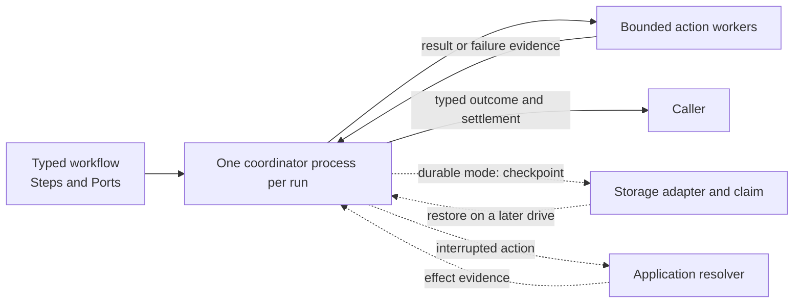

# Saga

Saga runs typed, source-authored workflows in Gleam on Erlang. It coordinates dependent steps and keeps typed evidence about failures, cleanup, and uncertain effects. Gleam 1.18 or later is required.

## When to use Saga

Use Saga when a business operation has known steps and dependencies, may need concurrent work, and needs explicit recovery when a step fails. Typical examples include reserving inventory before charging for an order, or driving a durable operation from an application-owned job or message handler.

Workflows are defined in Gleam code. Your application owns its clients, stable operation IDs, delivery, and the decision to drive or cancel durable work. Saga does not make remote effects transactional with checkpoints.

## Capabilities

- Define and validate typed workflows from steps and value ports.
- Share prerequisites, combine outputs, and select a workflow branch.
- Run ready steps concurrently with a per-run limit, attempt timeouts, and an optional deadline.
- Retry with an explicit policy, undo known completed steps, and retain cleanup failures.
- Cancel a local run, inspect progress, and receive a typed terminal outcome.
- Mark uncertain effects, choose retry or hold for reconciliation, and use a stable idempotency key across attempts.
- Add versioned codecs and effect resolvers to checkpoint and resume the same workflow.
- Store durable executions in memory, files, or the separate PostgreSQL adapter; reconnect, read, cancel, and list unfinished executions.
- Emit correlated Sinal telemetry and synchronize tests with `saga/testing`.

## Install

Add Saga from Hex:

```sh
gleam add saga
```

For PostgreSQL storage, add the adapter from its Git subdirectory:

```toml
[dependencies]
saga = ">= 0.1.0 and < 0.2.0"

# Optional: PostgreSQL storage for durable executions.
pog = ">= 4.1.0 and < 4.2.0"
saga_postgres = { git = "https://github.com/gleam-dream/saga.git", ref = "main", path = "integrations/saga_postgres" }
```

Commit `gleam.toml` and `manifest.toml` to retain the resolved versions and Git commit.
The PostgreSQL adapter borrows your application's `pog.Connection`; the application starts and owns the pool. See the [adapter guide](integrations/saga_postgres/README.md).

## How execution works

A workflow definition is built once. Each run gets an OTP coordinator process that admits ready steps up to its concurrency limit and starts isolated action workers. In durable mode, the driver claims storage and checkpoints progress; after an interrupted action, an application resolver reports whether it completed, was not sent, or may have been sent.



The caller owns a local run's lifetime: its exit cancels that run. A durable `drive` can be interrupted and resumed without recording cancellation; only `durable.cancel` records cancellation. The application owns the storage process, database pool, and job scheduling.

## Define a checkout workflow

The [checkout consumer](examples/order_consumer/src/order_consumer/usage/checkout.gleam)
uses simulated reservation and payment functions. It links their outputs, attaches
an undo to the reservation, and supplies a stable idempotency key to the charge.
Keep its retry policy only when your real provider makes replay safe.

<!-- prettier-ignore-start -->

<!-- snips: examples/order_consumer/src/order_consumer/usage/checkout.gleam#checkout -->
```gleam
import gleam/time/duration
import saga
import saga/execution
import saga/telemetry
import sinal
import sinal/correlation

pub type CheckoutError {
  OutOfStock
  Declined
  MaybeCharged
}

pub fn reserve(order: String) -> Result(String, CheckoutError) {
  Ok("hold-" <> order)
}

pub fn release(_hold: String) -> Result(Nil, CheckoutError) {
  Ok(Nil)
}

fn charge(
  reservation: String,
  idempotency_key key: String,
) -> Result(String, CheckoutError) {
  case reservation {
    "hold-declined" -> Error(Declined)
    _ -> Ok("receipt-" <> key)
  }
}

/// Two dependent steps: a reservation that can be undone and a payment whose
/// outcome may be unknown, with a compensation policy.
pub fn checkout() {
  let reserve =
    saga.step("reserve_inventory", reserve)
    |> saga.undo(fn(undo) { release(undo.output) })
  let charge =
    saga.effect("charge_payment", fn(reservation, key) {
      // `saga.idempotency_key(key)` is the same for every attempt of this step.
      charge(reservation, idempotency_key: saga.idempotency_key(key))
    })
    |> saga.unknown_when(fn(error) { error == MaybeCharged })
    |> saga.compensate(max_attempts: 3, with: fn(failed) {
      case failed.failure {
        saga.Returned(MaybeCharged) ->
          saga.RetryAfter(duration.milliseconds(500))
        saga.Returned(error) -> saga.Abort(error)
        saga.Crashed(_) | saga.TimedOut -> saga.Hold(MaybeCharged)
      }
    })
  saga.define("checkout", fn(order) {
    order |> saga.perform(reserve) |> saga.perform(charge)
  })
}

```

<!-- prettier-ignore-end -->

Only a known successful step enters the undo journal, and each undo callback is attempted once. Saga cannot reverse a provider request or a committed database write on its own. Use the `EffectKey` idempotency key with the external provider, and make recovery decisions from authoritative application evidence.

## Configure and run

Use `execution.run` for a blocking local run. Use `execution.start`, `progress`, `await`, and `cancel` when the caller needs to interact with a run. Concurrency is per run; a run deadline is optional. Configure a step timeout or run deadline to match the application's time budget, and consume the terminal report before dropping an unfinished handle.

## Persist and recover

Durable workflows require codecs for saved input and outputs, a workflow version, and resolvers for effects that may have been interrupted. Use the same stable execution ID and compatible encoded input when reconnecting; bump the workflow version when its behavior changes. `durable.drive`'s timeout bounds its work budget, but stopping workers and releasing a claim can make the call return later, so leave margin under an enclosing job deadline.

The example below calls the `persistence()` and `action_for()` helpers in the linked [durable example](examples/order_consumer/src/order_consumer/usage/durable_run.gleam). It uses memory storage to keep the code short; memory storage loses executions when its store or VM stops.

<!-- prettier-ignore-start -->

<!-- snips: examples/order_consumer/src/order_consumer/usage/durable_run.gleam#durable-run -->
```gleam
pub fn run() -> Nil {
  let assert Ok(store) = memory.start()
  let assert Ok(run) =
    durable.start_or_reconnect(
      persistence(),
      memory.storage(store),
      id: "checkout:o-1",
      input: "o-1",
    )
  let handled = case durable.drive(run, timeout: duration.seconds(30)) {
    Ok(execution.Completed(_)) -> "completed"
    Ok(_) -> "other outcome"
    Error(error) -> action_for(error)
  }
  let assert "completed" = handled
  memory.stop(store)
  Nil
}
```

<!-- prettier-ignore-end -->

Choose storage for the failure scope you need:

- `saga/storage/memory` serves one VM process and loses its records when that store stops.
- `saga/storage/file` recovers in a fresh VM when one VM at a time uses a canonical directory. It does not promise directory durability after power loss.
- [`saga_postgres`](integrations/saga_postgres) stores runs in a shared database for runners on one or several nodes and borrows your pool. Database and application effects still commit separately from Saga checkpoints.

Saga lists unfinished executions but does not schedule or drive them. Your application decides when to reconnect and call `durable.drive`. An interrupted external effect must be resolved before Saga can safely continue: report `Completed` only with proof, `NotSent` only when absence is known, and otherwise preserve uncertainty for reconciliation.

## Examples and references

The [order consumer](examples/order_consumer/README.md) is a separate Gleam package that compiles and runs examples for checkout, configuration, unknown effects, durable operations, reconnection, and committed-effect recovery. Its test suite exercises the public modules.

The [design PDF](docs/design/design-layer.pdf) describes execution and durability. The [coverage map](docs/COVERAGE.md) links implementation and evidence to those contexts. [Benchmark notes](docs/BENCHMARKS.md) explain the retained observational results and their limits; run `cd bench && gleam run` to measure a checkout. The historical measurements are not production performance claims.
